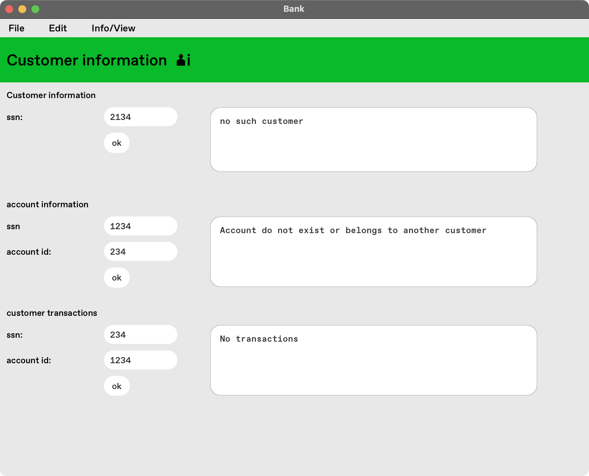
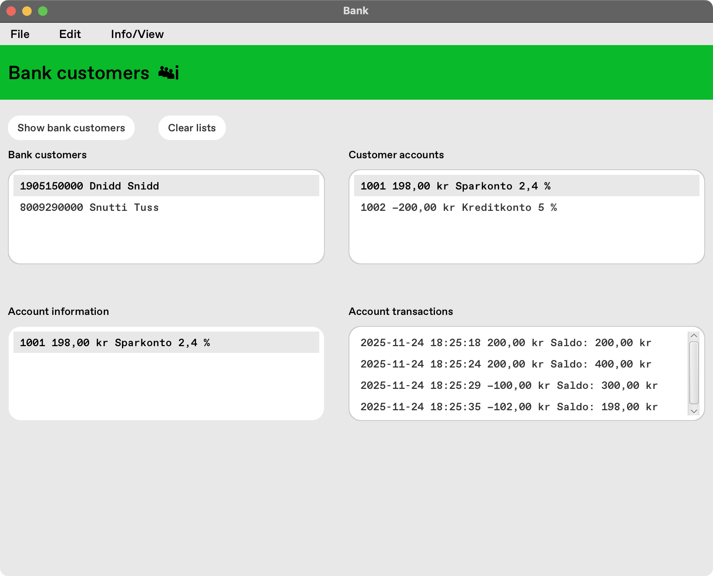
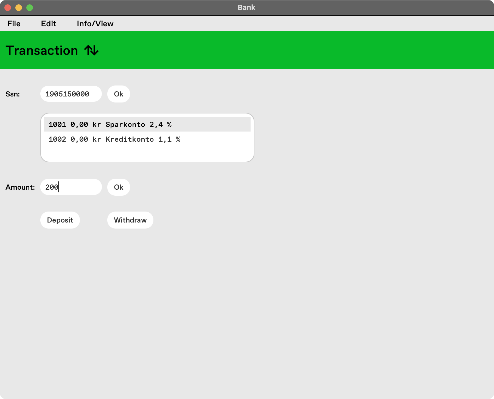
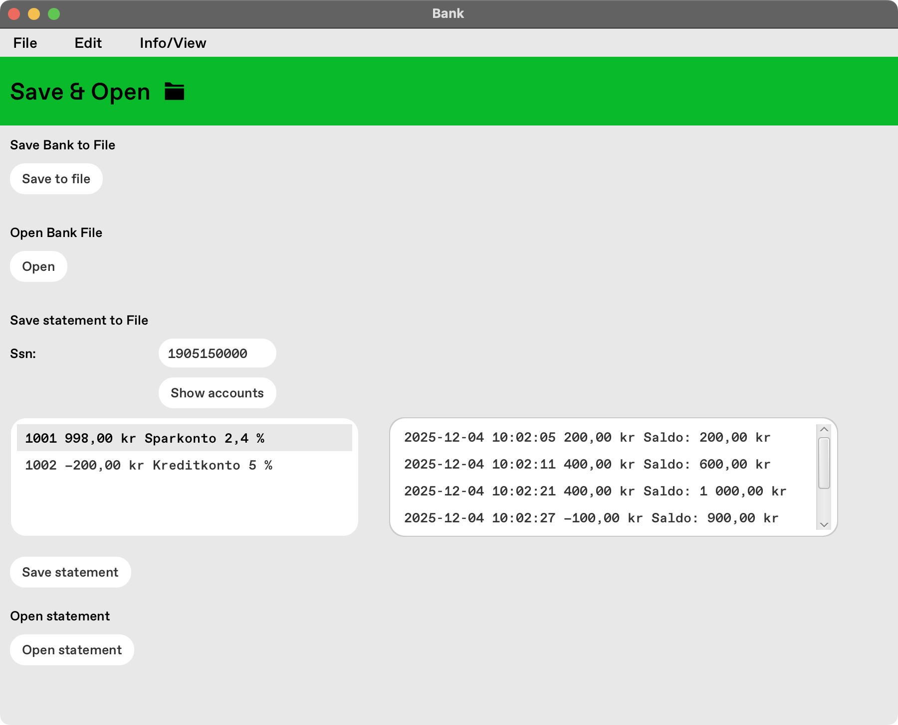
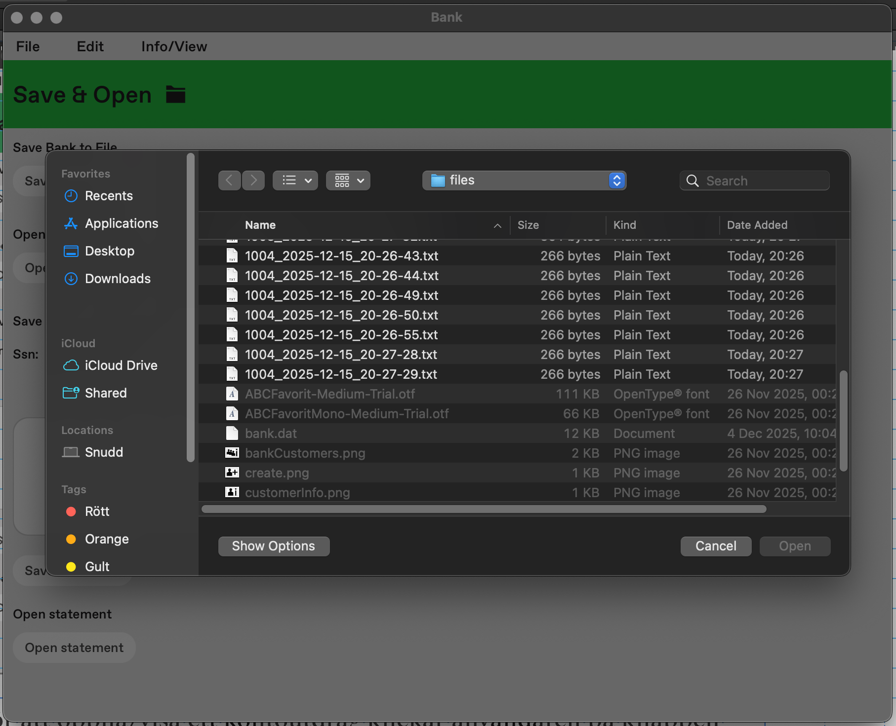
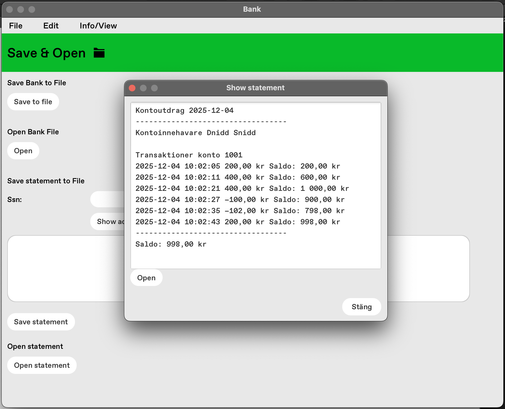

##### Banking application
Created in Eclipse using javafx-sdk-21.0.9
 
--------------------------------
##### Development environment

Create library to hold javafx .jar files.

- IDE: Eclipse
- Java: JDK 21
- JavaFX SDK: 21.0.9
- Eclipse plugin: e(fx)clipse

<b>JavaFX configuration</b>
1. Download and install JavaFX SDK 21.0.9.

2. Install the e(fx)clipse plugin in Eclipse.

3. Create a User Library in Eclipse containing the JavaFX .jar files from the SDK's lib directory (for example, named javafx).
4. Add the JavaFX libraries to the project's Modulepath, together with:
   
    - JavaFX21 
    - JavaFXSDK 
    - JRE System Library [JavaSE-21]
    

Make sure the JavaFX library paths point to the JavaFX SDK installation on your computer.

--------------------------------

 
Installing JavaFX on MacOs:
 
https://www.youtube.com/watch?v=-W_GyGZV_ro
 

--------------------------------

 
Login (view, (controller)) is only a mock-up.
 

##### Central parts:
Serialize and deserialize. 
serialVersionUID. 
Transient fields. 
Pseudo constructor method calling to recreate the transient fields from serialized read file. 
Polymorphism and inheritance. 
File handling. 
MVC. 
Error handling. 
UX and GUI. 
 
Inherited account types.
Bank stored as serialized files including transient field 
and pseudo constructors used for deserializing and recreating fields in objects.
Polymorphism used for account type and for determining account type.
 

UI implements for example fileChooser.

 

UI/GUI screenshots: 

